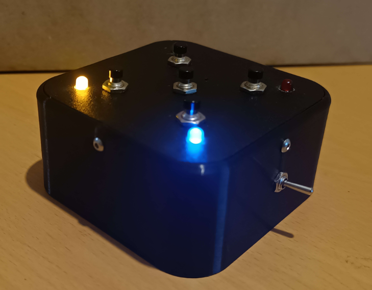
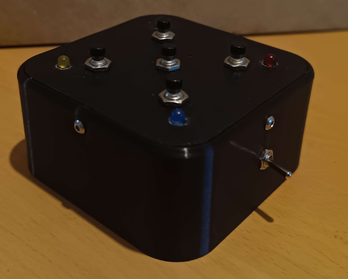
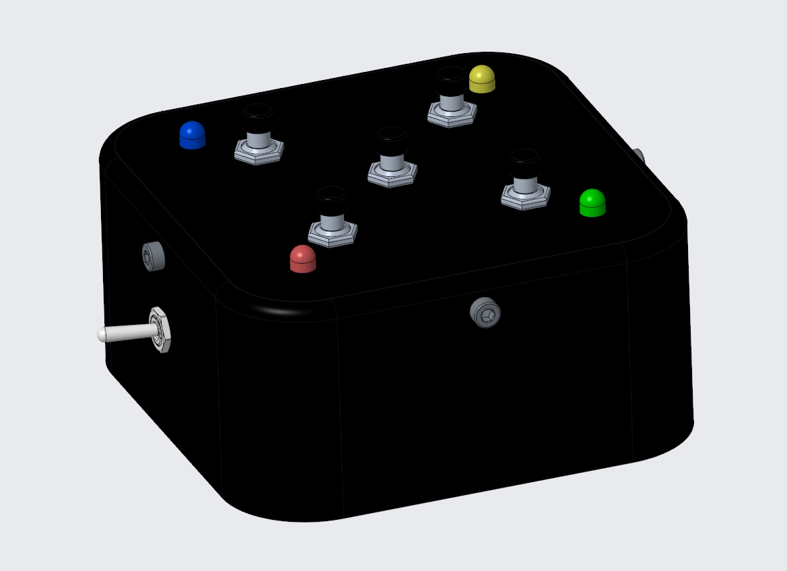
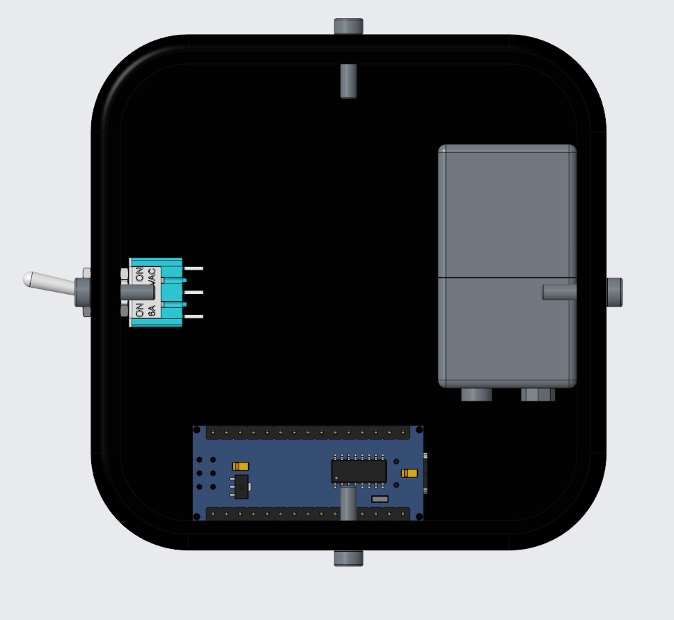
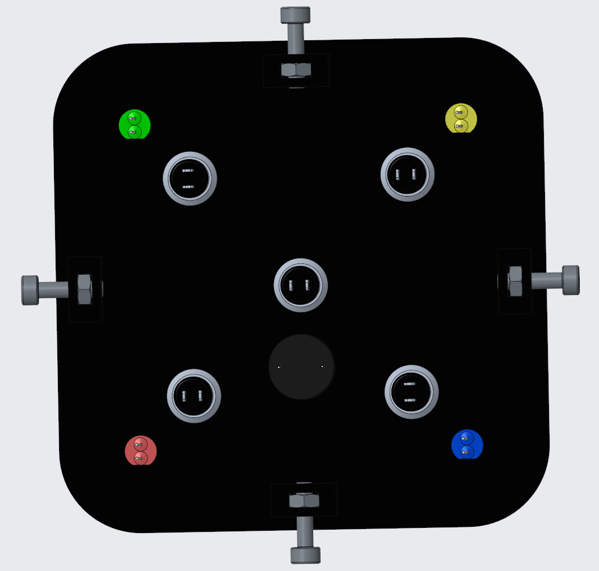
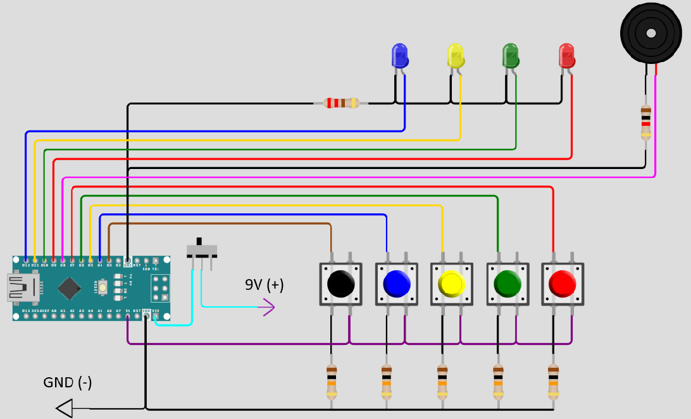

# color-pulse

**A handheld color memory game, powered by an Arduino Nano, with a 3D-printed enclosure, four LEDs and musical feedback.**


<p align="center">
  
</p>

> **Who is this for?** This project is aimed at **makers comfortable with soldering and basic electronics**. This README documents the key points, the pitfalls and the design choices, but it assumes **common sense and basic DIY skills** from the person following it: it is not a step-by-step tutorial for every wire. For the position of each component, refer to the **STEP assembly** in [`CAD/STEP/`](CAD/STEP/).

---

## Table of Contents

- [Overview](#overview)
- [Gallery](#gallery)
- [Specifications](#specifications)
- [Bill of Materials (BOM)](#bill-of-materials-bom)
- [Tools](#tools)
- [Manufacturing](#manufacturing)
- [Assembly](#assembly)
- [Electronics and Wiring](#electronics-and-wiring)
- [Controls](#controls)
- [Software: Arduino](#software-arduino)
- [How to Play](#how-to-play)
- [License](#license)

---

## Overview

Color Pulse is a **portable, single-player memory game**: watch a sequence of colored lights, listen to their notes, then repeat the sequence using the matching buttons.

- **Enclosure**: two **3D-printed parts**, assembled with M3 screws and captive nuts.
- **Core**: an **Arduino Nano** running the provided sketch.
- **Controls**: four color input buttons and one central Start button.
- **Feedback**: four colored LEDs and a **passive buzzer**, with a different note for each color.
- **Power**: a **9 V battery**, with a side-mounted ON/OFF switch.

Each successful round adds **one new color** to the sequence. The game ends after a wrong input, a timeout, or completion of all **100 levels**.

All original source files are provided, including the Arduino sketch, printable enclosure parts and complete STEP assembly.

---

## Gallery

### Real game

| Powered on | Powered off |
| :---: | :---: |
|  |  |

### CAD model

| Assembled game | Inside the bottom enclosure | Inside the top faceplate |
| :---: | :---: | :---: |
|  |  |  |

### Video demonstration

https://github.com/user-attachments/assets/b7691095-c089-4e3e-bee0-d50d5bb0e221

> Local video file: [`Media/demo.mp4`](Media/demo.mp4)

---

## Specifications

| Item | Detail |
| :--- | :--- |
| **Microcontroller** | Arduino Nano, ATmega328P |
| **Players** | 1 |
| **Controls** | 4 color buttons + 1 central Start button |
| **Visual feedback** | 4 × 5 mm LEDs: red, green, yellow and blue |
| **Audio** | Passive piezo buzzer, with a dedicated note for each color |
| **Power** | 9 V battery connected to VIN through an ON/OFF switch |
| **Enclosure** | 2 custom 3D-printed parts |
| **Original printing material** | TPU 64D |
| **Fasteners** | 4 × M3 × 12 mm socket head screws + 4 × M3 nuts |
| **Maximum level** | 100 |
| **Input timeout** | 5 seconds per expected button press |
| **Software** | Arduino sketch included in the repository |

---

## Bill of Materials (BOM)

The complete, detailed list is in **[BOM.md](BOM.md)**. It covers:

1. **Electronics**: Arduino Nano, buttons, LEDs, buzzer, resistors, battery and switch.
2. **Hardware**: M3 screws, nuts and mounting supplies.
3. **3D-printed parts**: the two enclosure files.
4. **Required tools**: soldering equipment, hand tools and programming cable.

> **Check component dimensions before buying**: the enclosure is designed around **Ø 7 mm threaded pushbutton bodies**, a **Ø 6 mm threaded toggle switch body** and **Ø 5 mm LEDs**. Check your components against the CAD model before printing.

---

## Tools

### Machines used

| Machine | Used for |
| :--- | :--- |
| **FDM 3D printer** | Bottom enclosure and top faceplate |

The original enclosure parts were printed in **TPU 64D**. Check the dimensions of the parts against your printer's build volume before starting.

### Hand tools

- Soldering iron and solder
- Wire strippers and flush cutters
- Hot glue gun
- **2.5 mm hex key** for the M3 socket head screws
- Small wrench or pliers for the pushbutton and switch mounting nuts
- USB cable matching your Arduino Nano board
- **Recommended**: a multimeter for checking continuity, polarity and short circuits before powering the game

---

## Manufacturing

### What the CAD files contain

The [`CAD/`](CAD/) folder is split in two:

- **`3MF/`**: the two 3D-printable enclosure parts.
- **`STEP/`**: the **complete 3D assembly** (`color_pulse_asm.stp`). Open it in your CAD software to see where each component goes during assembly.

The electronic components and fasteners shown in the STEP assembly are reference models, not parts to print.

### 3D printing

The files are in [`CAD/3MF/`](CAD/3MF/). The original parts were printed in **TPU 64D**.

**PLA, PETG or ABS may also be suitable, but have not been tested for this project.** Softer, more flexible materials are discouraged because the enclosure needs to hold the buttons, fasteners and internal components securely.

Use settings appropriate for your printer and material.

| File | Qty | Purpose |
| :--- | :---: | :--- |
| [`box.3mf`](CAD/3MF/box.3mf) | 1 | Bottom enclosure, with the side power switch opening |
| [`top.3mf`](CAD/3MF/top.3mf) | 1 | Top faceplate, with button and LED holes and internal nut pockets |

> **Check the fit before assembly**: test the pushbuttons, LEDs, toggle switch and M3 nuts in their respective openings before soldering and securing the electronics.

---

## Assembly

The enclosure is assembled with **4 × M3 × 12 mm socket head screws**, driven through the side walls of the bottom enclosure into **M3 nuts held inside the top faceplate**.

Unlike the enclosure screws, several internal components are secured with **hot glue**.

### Recommended assembly order

1. **Print and inspect both enclosure parts.** Remove any printing residue that could interfere with the component openings or mating surfaces.
2. **Install the four M3 nuts** in the pockets inside the top faceplate (`top`). Hold them in place with a small drop of hot glue, keeping glue out of the threads.
3. **Mount the five pushbuttons** on the top faceplate and secure them with their supplied nuts.
4. **Insert the four LEDs** into their corner openings. Check the color positions against the CAD assembly and secure the LEDs from inside with hot glue.
5. **Mount the passive buzzer** under the top faceplate.
6. **Install the toggle switch** in the side opening of the bottom enclosure (`box`) and secure it with its mounting nut.
7. **Wire the electronics** following the wiring diagram and pin assignment below.
8. **Upload the sketch and test the game** before closing the enclosure.
9. **Secure the Arduino Nano and battery** inside the bottom enclosure, then arrange the wiring so nothing is pinched.
10. **Fit the top faceplate** and fasten it with the four M3 screws. Tighten gently.

### Top faceplate

<p align="center">
  
</p>

The top faceplate carries:

- the **four color input buttons**;
- the **central Start button**;
- the **four LEDs**;
- the **passive buzzer**;
- the **four captive M3 nuts** used to close the enclosure.

Use the STEP assembly to check component positions. The internal view is seen from underneath, so its layout appears reversed compared with the outside view.

### Bottom enclosure

<p align="center">
  
</p>

The Arduino Nano and battery sit inside the bottom enclosure, with the toggle switch mounted on the side.

- **Arduino Nano**: secure it inside the enclosure with hot glue after programming and testing.
- **Battery**: position it as shown in the CAD assembly. Keep the snap connector accessible for replacement.
- **Wiring**: leave enough slack to open the enclosure without pulling on solder joints.
- **Insulation**: insulate exposed joints and resistor leads so they cannot touch adjacent connections.

Direct soldered connections are recommended for a compact, reliable assembly. The enclosure also has clearance for Dupont jumper wires if preferred.

> **Before closing**: check that the USB connector remains accessible when the enclosure is open, the power switch works, and no wire sits between the mating edges or in the screw paths.

---

## Electronics and Wiring

<p align="center">
  
</p>

- **Power**: the battery positive lead runs through the **ON/OFF switch** to the Nano's **VIN** pin. The battery negative connects to **GND**.
- **Buttons**: each input uses an external **10 kΩ pull-down resistor**. Pressing a button connects its input to **5 V**, producing a HIGH signal.
- **LEDs**: the four LEDs are driven by **D9–D12**, with their shared cathode return connected to GND through the **220 Ω resistor** shown in the diagram.
- **Audio**: the passive buzzer is driven from **D8**, through the **1 kΩ series resistor** shown in the diagram.
- **Ground**: all parts share a common **GND**.

### Pin assignment

The color order in the sketch is **red, green, yellow, blue**.

| Component | Arduino Nano pin |
| :--- | :--- |
| **Red button** | D7 |
| **Green button** | D6 |
| **Yellow button** | D5 |
| **Blue button** | D4 |
| **Central Start button** | D3 |
| **Red LED** | D9 |
| **Green LED** | D10 |
| **Yellow LED** | D11 |
| **Blue LED** | D12 |
| **Passive buzzer** | D8 |
| **Battery positive, through the switch** | VIN |
| **Common ground** | GND |

The sketch uses:

```cpp
// Order: red, green, yellow, blue.
const byte LED_PINS[4] = {9, 10, 11, 12};

// Order: red, green, yellow, blue, start.
const byte BUTTON_PINS[5] = {7, 6, 5, 4, 3};

const byte BUZZER_PIN = 8;
const byte PRESSED = HIGH;
```

> **Button wiring**: the supplied build uses external pull-down resistors and `PRESSED = HIGH`. The sketch also supports an alternative wiring arrangement using buttons connected to GND and `INPUT_PULLUP`, selected by changing `PRESSED` to `LOW`. Do not change this setting without adapting the wiring accordingly.

> **Passive buzzer required**: use a buzzer without an internal oscillator. The sketch generates the notes with `tone()`; an active buzzer will not reproduce the intended pitches.

> **Shared LED resistor**: the supplied diagram uses one common 220 Ω resistor. Several LEDs light together during the defeat animation, so their brightness may differ from the single-LED animations.

> **Safety**: disconnect the battery and USB cable before soldering or modifying the wiring. Check polarity and insulation before powering the game. Never connect the 9 V battery directly to the 5 V pin or an input/output pin.

---

## Controls

### Top faceplate and side switch

| Control | Function |
| :--- | :--- |
| **Red button** | Enter red during the player's turn. |
| **Green button** | Enter green during the player's turn. |
| **Yellow button** | Enter yellow during the player's turn. |
| **Blue button** | Enter blue during the player's turn. |
| **Central button** | Start a new game while the waiting animation is running. |
| **Side toggle switch** | Turn battery power ON or OFF. |

> **The central button is not a Reset button.** It is checked only while the game is waiting to start. Pressing it during a sequence or a player's turn does not restart the game.

### Color notes

Each color has a fixed musical note, used both during sequence playback and when the player enters a color.

| Color | Note | Frequency |
| :--- | :--- | :--- |
| **Red** | C4 | 262 Hz |
| **Green** | E4 | 330 Hz |
| **Yellow** | G4 | 392 Hz |
| **Blue** | C5 | 523 Hz |

---

## Software: Arduino

The game runs the sketch provided in [`Code/color_pulse_arduino_code/color_pulse_arduino_code.ino`](Code/color_pulse_arduino_code/color_pulse_arduino_code.ino).

It uses the **Arduino core**, with **no additional libraries required**.

### Uploading the sketch

1. **Disconnect the battery** before connecting the Nano to your computer.
2. **Open the sketch** in the Arduino IDE.
3. **Select the board and serial port** matching your Arduino Nano. Select the appropriate processor or bootloader option for your board.
4. **Upload the sketch** using a compatible USB cable.
5. **Test the controls, LEDs and buzzer** before final assembly.
6. **Disconnect USB**, reconnect the battery and test the side power switch.

### Game settings

The main settings are defined near the beginning of the sketch:

| Setting | Default | Purpose |
| :--- | :--- | :--- |
| `MAX_LEVEL` | `100` | Maximum sequence length and final level |
| `TIMEOUT_MS` | `5000UL` | Time allowed for each expected color input |
| `DEBOUNCE_MS` | `30UL` | Button debounce interval |
| `PRESSED` | `HIGH` | Active button state for the supplied pull-down wiring |
| `COLOR_NOTES` | `262, 330, 392, 523` | Frequencies assigned to the four colors |

The sequence is generated one color at a time using Arduino's pseudo-random generator. At the beginning of each game, the generator is seeded using a reading from **A0** and the elapsed microseconds.

**A0 is intentionally left unconnected** in this build.

> **Inputs during playback**: the game accepts color inputs only during the player's turn, not while it is showing the sequence or playing feedback sounds.

---

## How to Play

### Start a game

1. Turn the side switch **ON**.
2. The game plays a short startup sequence, lighting each color with its associated note.
3. A repeating **LED chase animation** indicates that the game is waiting.
4. Press the **central Start button** to begin.

### Repeat the sequence

1. Watch and listen as the game plays the sequence.
2. Once playback finishes, press the matching color buttons **in the same order**.
3. Each accepted press lights its LED and plays its note.
4. Complete the sequence correctly to hear the success sound and advance to the next level.

The first level contains **one color**. Each following level adds **one more color** to the existing sequence.

Colors can repeat, including consecutive repetitions of the same color.

Release a button before pressing it again: holding a button does not generate repeated inputs. Press one button at a time.

### Timeout and defeat

You have **5 seconds for each expected button press**, not 5 seconds for the entire sequence.

The game ends if:

- you press the **wrong color**;
- you do not provide the next input before the **timeout**.

A descending sound and **three flashes of all LEDs** signal defeat. The game then returns to the waiting animation.

Press the central button to start again from level 1 with a newly generated sequence.

### Victory

Complete **level 100** to trigger the victory melody and light animation.

The game then returns to the waiting animation, ready for another game.

---

## License

The original work in this project is released under the **[Creative Commons BY-NC 4.0](LICENSE)** license.

This includes the **Arduino source code**, **custom enclosure parts**, **wiring diagram**, **photographs** and **documentation**, as described in the license file.

**You can**:
- build the game for yourself or as a gift;
- modify the code and enclosure files for non-commercial use;
- share your builds and remixes with attribution to the author and an indication of any modifications.

**You cannot, without written agreement**:
- sell the original files;
- sell kits, printed enclosures or assembled games based on this design;
- make any other commercial use of the original work.

**Third-party CAD components**: the standard electronic and mechanical component models included in the STEP assembly are excluded from the author's original licensed material. They remain subject to their respective creators' terms. See [LICENSE](LICENSE) for details.

**Commercial licensing, kit manufacturing or partnerships**: Antoine Navarro EI (CeleauTech), [celeautech.contact@gmail.com](mailto:celeautech.contact@gmail.com)

---

<p align="center">
  Designed and built by <b>CeleauTech</b><br>
  If you like this project, feel free to leave a star on the repository and share your build!
</p>
